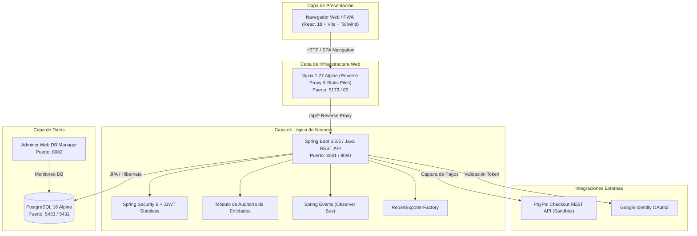
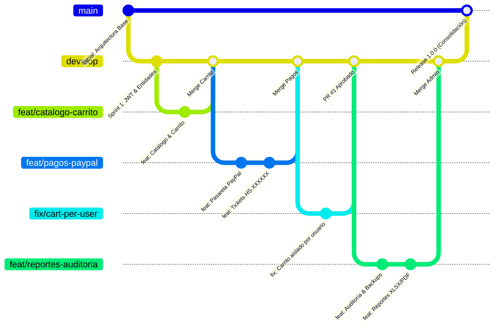
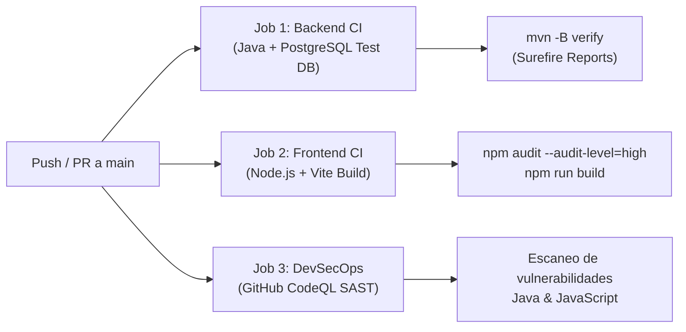
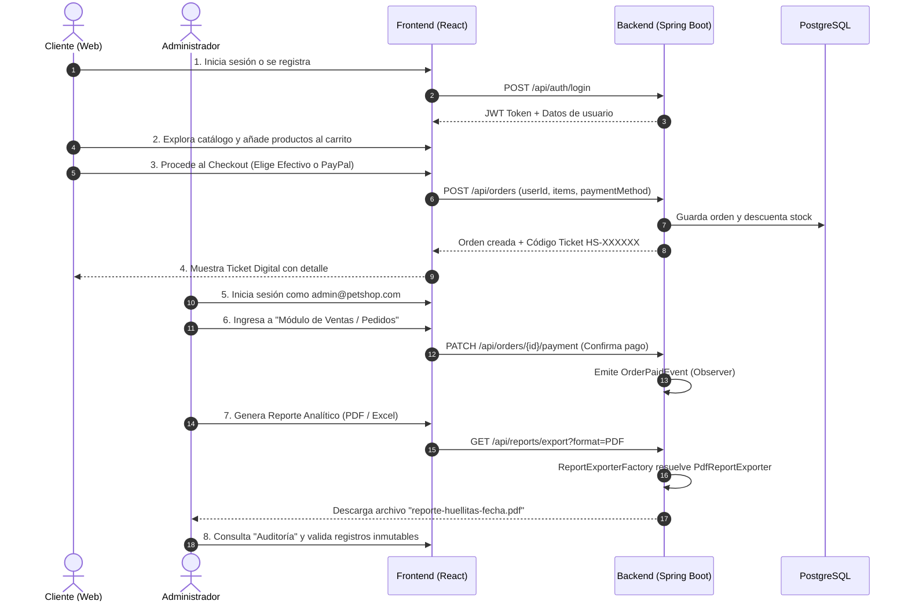

# CONSOLIDACIÓN FUNCIONAL DEL PROYECTO DE SOFTWARE
## Huellitas Shop - Plataforma E-commerce & Panel Administrativo Full Stack

---

## Ficha Técnica de la Entrega

| Parámetro | Detalle |
| :--- | :--- |
| **Proyecto:** | **Huellitas Shop** |
| **Tipo de Sistema:** | Plataforma E-commerce Web Transaccional & Panel Administrativo |
| **Asignatura:** | Ingeniería de Software Avanzada |
| **Fecha de Consolidación:** | Semestre Académico 2026 |
| **Zona Horaria Oficial:** | `America/Bogota` (JVM, Hibernate, Jackson, Frontend) |
| **Moneda Oficial:** | Pesos Colombianos (`COP`) |
| **Arquitectura:** | Clean Architecture / MVC REST desacoplado + SPA React + Nginx Proxy |
| **Estado:** | **Versión Funcional Consolidada (Production-Ready)** |

---

## Tabla de Contenido
1. [Componente 1: Sistema Funcional y Alcance Definido](#1-sistema-funcional-y-alcance-definido)
   - 1.1. Arquitectura General y Tecnologías
   - 1.2. Módulos Funcionales Implementados
   - 1.3. Matriz de Calidad del Producto Software (Norma ISO/IEC 25010)
2. [Componente 2: Implementación de Patrones de Diseño](#2-implementación-de-patrones-de-diseño)
   - 2.1. Patrón Observer (Comportamiento)
   - 2.2. Patrón Factory (Creacional)
   - 2.3. Patrón Singleton (Creacional)
   - 2.4. Matriz Resumen y Verificación de Pruebas Unitarias
3. [Componente 3: Evidencia de Metodologías Ágiles y Gestión de Deuda Técnica](#3-evidencia-de-metodologías-ágiles-y-gestión-de-deuda-técnica)
   - 3.1. Marco Metodológico: Scrumban y Gitflow
   - 3.2. Desglose Cronológico de Sprints e Historias de Usuario (INVEST)
   - 3.3. Trazabilidad en Git: Ramas, Commits Semánticos y Pull Requests
   - 3.4. Gestión de Deuda Técnica y Buenas Prácticas (Clean Code & SOLID)
   - 3.5. Pipeline de Integración Continua (CI/CD) y Análisis Estático
4. [Componente 4: Guía de Ejecución Funcional del Sistema](#4-guía-de-ejecución-funcional-del-sistema)
   - 4.1. Ejecución con Docker Compose (Recomendada)
   - 4.2. Ejecución Local Independiente (Entorno de Desarrollo)
   - 4.3. Credenciales y Cuentas Preconfiguradas
   - 4.4. Procedimiento de Verificación y Flujo de Compra Paso a Paso
5. [Conclusiones del Proyecto](#5-conclusiones-del-proyecto)

---

## 1. Sistema Funcional y Alcance Definido

### 1.1. Arquitectura General y Tecnologías

Huellitas Shop está concebido como un sistema desacoplado de alto rendimiento y arquitectura en capas (*Clean Architecture* / MVC para API REST), diseñado bajo las directrices del desarrollo de software moderno y los principios 12-Factor App.



- **Backend:** Java 17/25, Spring Boot 3.3.5, Spring Security 6, Spring Data JPA, Hibernate ORM, JJWT 0.12.6, Apache POI 5.3.0, OpenPDF 1.3.43.
- **Frontend:** React 18.3, Vite 5.4, Tailwind CSS 3.4, React Router DOM v6, `@react-oauth/google`, Axios (con interceptores para manejo de tokens y concurrencia), Soporte PWA con Service Worker.
- **Base de Datos:** PostgreSQL 16 Alpine orquestada con volúmenes persistentes y motor relacional ACID.
- **Infraestructura:** Docker Compose multi-stage y servidor web Nginx con gzip, caché estática y proxy seguro.

---

### 1.2. Módulos Funcionales Implementados

| Módulo | Alcance Funcional | Perfiles con Acceso |
| :--- | :--- | :--- |
| **Autenticación y Sesiones** | Registro público de clientes, inicio de sesión tradicional y con Google OAuth2, cierre de sesión, control de inactividad automática (2 min), y **política estricta de sesión única** por usuario (emite `SESSION_REPLACED` ante intentos de concurrencia). | Público / Autenticado |
| **Catálogo de Productos** | Exploración pública de catálogo, filtrado dinámico por categoría (Alimentos, Accesorios, Juguetes, Higiene, Salud), búsqueda textual reactiva, paginación y visualización de stock disponible en COP. | Público / Todos |
| **Carrito de Compras** | Carrito interactivo almacenado de forma persistente y aislada en `localStorage` por identificador único de usuario autenticado; previene fuga de información entre sesiones. | `CUSTOMER` |
| **Checkout y Pagos Duales** | Flujo de compra transaccional atómico: selección de método de pago entre **PayPal** (pasarela sandbox con creación y captura de orden) y **Efectivo / Transferencia** (pago en tienda con confirmación administrativa). | `CUSTOMER`, `ADMIN`, `EMPLOYEE` |
| **Tickets Digitales** | Generación inmediata de comprobante de compra con código único de orden (`HS-XXXXXX`), resumen de ítems adquiridos, desglose de impuestos, total en COP y estado del pago. | `CUSTOMER`, `ADMIN`, `EMPLOYEE` |
| **Gestión de Pedidos** | Trazabilidad del ciclo de vida de la orden a través de estados: `PENDING` -> `PAID` -> `SHIPPED` -> `CANCELLED`. Los clientes consultan su historial propio (`Mis Compras`) y el personal administra todos los pedidos. | `CUSTOMER` (propios), `ADMIN`, `EMPLOYEE` (todos) |
| **Panel Administrativo** | Dashboard centralizado con métricas clave de facturación, resumen de ventas, gestión de catálogo (creación, edición, activación/desactivación de stock) y administración de usuarios. | `ADMIN`, `EMPLOYEE` |
| **Reportería Analítica** | Generación de reportes de ventas consolidados con filtros por rango de fechas y exportación dual a formatos profesionales **Excel (.xlsx)** y **PDF (.pdf)** con cálculo de métricas financieras. | `ADMIN`, `EMPLOYEE` |
| **Auditoría Transaccional** | Módulo de logs inmutables (`AuditLog`): registra actor, acción (`LOGIN_SUCCESS`, `CREATE`, `UPDATE`, `DELETE`), entidad impactada, valores antes/después y marca temporal con zona horaria de Bogotá. | `ADMIN`, `EMPLOYEE` |
| **Copias de Seguridad (Backups)** | Generación y descarga directa de respaldos SQL completos de la base de datos PostgreSQL en tiempo de ejecución, así como mecanismo de restauración controlada. | `ADMIN` |

---

### 1.3. Matriz de Calidad del Producto Software (Norma ISO/IEC 25010)

En cumplimiento de los conceptos evaluados durante el curso de Ingeniería de Software Avanzada, la plataforma Huellitas Shop fue diseñada e implementada bajo las 8 características de calidad del estándar **ISO/IEC 25010**:

| Característica ISO 25010 | Subcaracterísticas Clave | Implementación en Huellitas Shop |
| :--- | :--- | :--- |
| **1. Adecuación Funcional** | Completitud, Corrección y Pertinencia funcional | Se cubren al 100% los requerimientos de una tienda de mascotas transaccional, con validaciones estrictas en DTOs (`@Valid`, `@NotNull`, `@Min`) y coherencia en el flujo de negocio (disminución de stock, validación de montos). |
| **2. Eficiencia de Desempeño** | Comportamiento temporal, Utilización de recursos, Capacidad | Arquitectura Stateless basada en JWT, transacciones JPA de solo lectura (`@Transactional(readOnly = true)`) para consultas, índices relacionales en PostgreSQL y construcción frontend optimizada con Vite + Rollup con compresión gzip. |
| **3. Compatibilidad** | Coexistencia e Interoperabilidad | Interoperabilidad a través de API REST estándar con contratos JSON y documentación OpenAPI 3.0 (Swagger). Coexistencia en red interna Docker entre Nginx, Spring Boot y PostgreSQL sin colisión de puertos. |
| **4. Capacidad de Interacción (Usabilidad)** | Aprendizabilidad, Operabilidad, Protección ante errores, Inclusividad | Interfaz reactiva e intuitiva desarrollada con Tailwind CSS, retroalimentación visual de errores mediante toasts y alertas, soporte para **Modo Claro / Modo Oscuro**, soporte bilingüe (i18n) e instalación como **PWA** en dispositivos móviles y de escritorio. |
| **5. Fiabilidad** | Madurez, Disponibilidad, Tolerancia a fallos, Recuperabilidad | Manejador global de excepciones (`GlobalExceptionHandler`) que previene caídas inesperadas del servidor y estandariza las respuestas `ApiError`. Recuperabilidad garantizada mediante el módulo de respaldos SQL en caliente (`/api/backup/download`). |
| **6. Seguridad** | Confidencialidad, Integridad, No-repudio, Autenticidad, Resistencia | Cifrado de credenciales con BCrypt, tokens JWT firmados con HMAC-SHA256, protección contra escalada de privilegios (RBAC estricto), política de sesión única simultánea, guardia contra inactividad (2 min) y registro de auditoría inmutable de accesos y mutaciones. |
| **7. Mantenibilidad** | Modularidad, Reusabilidad, Analizabilidad, Capacidad de ser probado | Arquitectura en capas claramente delimitadas (Controller -> Service -> Repository -> Entity), aplicación de patrones de diseño GoF, principios SOLID, nombres de dominio reveladores y suite de pruebas unitarias automatizadas con Mockito y MockMvc. |
| **8. Flexibilidad / Portabilidad** | Adaptabilidad, Escalabilidad, Instalabilidad | Configuración gobernada bajo el estándar 12-Factor App mediante variables de entorno (`.env`), portabilidad total mediante contenedores Docker y Docker Compose independientes del sistema operativo anfitrión. |

---

## 2. Implementación de Patrones de Diseño

El sistema incorpora tres patrones de diseño fundamentales de la ingeniería de software (uno de comportamiento y dos creacionales), superando el requisito mínimo de la cátedra:

```mermaid
classDiagram
    direction TB

    %% Patrón Factory
    class ReportExporter {
        <<interface>>
        +format() ReportFormat
        +export(ReportSummary summary) byte[]
    }
    class PdfReportExporter {
        +format() ReportFormat
        +export(ReportSummary summary) byte[]
    }
    class ExcelReportExporter {
        +format() ReportFormat
        +export(ReportSummary summary) byte[]
    }
    class ReportExporterFactory {
        -Map~ReportFormat, ReportExporter~ exporters
        +getExporter(ReportFormat format) ReportExporter
    }
    ReportExporter <|.. PdfReportExporter
    ReportExporter <|.. ExcelReportExporter
    ReportExporterFactory ..> ReportExporter : instancía / resuelve
    ReportService --> ReportExporterFactory : utiliza

    %% Patrón Observer
    class ApplicationEventPublisher {
        <<Spring Context>>
        +publishEvent(Object event)
    }
    class OrderPaidEvent {
        +Long orderId
    }
    class OrderPaidListener {
        +onOrderPaid(OrderPaidEvent event)
    }
    OrderService ..> ApplicationEventPublisher : publica evento
    ApplicationEventPublisher ..> OrderPaidListener : notifica observador
    OrderPaidListener ..> OrderPaidEvent : procesa

    %% Patrón Singleton
    class SystemConfigurationRegistry {
        -Instant startupTime
        -Map properties
        -SystemConfigurationRegistry()
        +getInstance()$ SystemConfigurationRegistry
        +getProperty(String key) Object
        +setProperty(String key, Object value)
    }
    class SingletonHolder {
        -INSTANCE$ SystemConfigurationRegistry
    }
    SystemConfigurationRegistry +-- SingletonHolder
```

---

### 2.1. Patrón Observer (Comportamiento)

#### Propósito:
Desacoplar la lógica de procesamiento de pagos (como el envío de notificaciones, el descuento final de inventario y la auditoría) de las clases transaccionales directas (`OrderService` y `PayPalService`), permitiendo que múltiples oyentes reaccionen a la finalización de una compra sin introducir acoplamiento innecesario.

#### Componentes en el Proyecto:
1. **Sujeto / Emisor (`ApplicationEventPublisher`):** `OrderService.java` y `PayPalService.java`.
2. **Evento (`OrderPaidEvent.java`):**
   ```java
   package com.petshop.event;

   public record OrderPaidEvent(Long orderId) {
   }
   ```
3. **Observador (`OrderPaidListener.java`):**
   ```java
   @Slf4j
   @Component
   public class OrderPaidListener {

       @TransactionalEventListener(phase = TransactionPhase.AFTER_COMMIT)
       public void onOrderPaid(OrderPaidEvent event) {
           log.info("Pedido {} pagado exitosamente. Ejecutando lógica desacoplada post-pago.", event.orderId());
           // Permite extender acciones (notificaciones, analítica, fidelización)
           // sin modificar los servicios de pago.
       }
   }
   ```
4. **Observadores de Seguridad y Persistencia:**
   - `AuthenticationAuditListener`: Observa los eventos de Spring Security `AuthenticationSuccessEvent` y `AbstractAuthenticationFailureEvent` para registrar inicios de sesión sin alterar los filtros de seguridad.
   - `HibernateAuditListener`: Implementa los listeners de eventos de ciclo de vida de Hibernate (`PostInsertEventListener`, `PostUpdateEventListener`, `PostDeleteEventListener`) para capturar automáticamente auditorías de cambios en la base de datos.

---

### 2.2. Patrón Factory (Creacional)

#### Propósito:
Encapsular la lógica de creación y resolución de exportadores de reportes, delegando la responsabilidad de seleccionar la estrategia de exportación adecuada (PDF o Excel) a una clase especializada (`ReportExporterFactory`), en lugar de que el servicio de negocio `ReportService` mantenga dicha lógica condicional.

#### Cumplimiento de Principios SOLID:
- **Single Responsibility Principle (SRP):** `ReportService` se concentra en la agregación de datos de órdenes; `ReportExporterFactory` se concentra exclusivamente en la selección del exportador correspondiente.
- **Open/Closed Principle (OCP):** Para soportar un nuevo formato de reporte (por ejemplo, CSV o JSON), solo es necesario crear una nueva clase que implemente `ReportExporter`; la fábrica lo detecta automáticamente mediante inyección de dependencias sin modificar una sola línea de código existente.

#### Implementación del Código Fuente:
**Fábrica (`ReportExporterFactory.java`):**
```java
package com.petshop.service.report.factory;

import com.petshop.dto.report.ReportFormat;
import com.petshop.exception.BadRequestException;
import com.petshop.service.report.ReportExporter;
import org.springframework.stereotype.Component;

import java.util.List;
import java.util.Map;
import java.util.function.Function;
import java.util.stream.Collectors;

@Component
public class ReportExporterFactory {

    private final Map<ReportFormat, ReportExporter> exporters;

    public ReportExporterFactory(List<ReportExporter> exporterList) {
        this.exporters = exporterList.stream()
                .collect(Collectors.toMap(ReportExporter::format, Function.identity()));
    }

    public ReportExporter getExporter(ReportFormat format) {
        if (format == null) {
            throw new BadRequestException("El formato de reporte no puede ser nulo");
        }
        ReportExporter exporter = exporters.get(format);
        if (exporter == null) {
            throw new BadRequestException("Formato de reporte no soportado: " + format);
        }
        return exporter;
    }
}
```

**Uso desacoplado en el Servicio (`ReportService.java`):**
```java
@Service
@Transactional(readOnly = true)
public class ReportService {

    private final PetOrderRepository orderRepository;
    private final ReportAggregator aggregator;
    private final ReportExporterFactory exporterFactory;

    public ReportService(PetOrderRepository orderRepository,
                         ReportAggregator aggregator,
                         ReportExporterFactory exporterFactory) {
        this.orderRepository = orderRepository;
        this.aggregator = aggregator;
        this.exporterFactory = exporterFactory;
    }

    public ExportedReport export(ReportFormat format, ReportFilter filter) {
        ReportExporter exporter = exporterFactory.getExporter(format);
        byte[] content = exporter.export(buildSummary(filter));
        String fileName = "reporte-huellitas-" + LocalDate.now() + "." + format.extension();
        return new ExportedReport(fileName, format.mediaType(), content);
    }
}
```

---

### 2.3. Patrón Singleton (Creacional)

#### Propósito:
Garantizar la existencia de una única instancia en memoria para la administración global de configuraciones, estado de arranque y metadatos de runtime de Huellitas Shop, proveyendo un punto de acceso global y seguro ante accesos concurrentes (thread-safe).

#### Enfoque Dual en el Proyecto:
1. **Singleton a nivel de Framework (Spring IoC Container Scope):**
   - En Spring Boot, todos los componentes anotados con `@Service`, `@Component`, `@RestController` y `@Configuration` (`SecurityConfig`, `JwtService`, `ActiveSessionService`, `ReportService`, etc.) son administrados por el ApplicationContext como **Singletons** por defecto, garantizando unicidad y optimización de recursos de memoria en el servidor.
2. **Singleton Canónico GoF (Bill Pugh Singleton Pattern):**
   - Para demostrar la comprensión formal del patrón a nivel de lenguaje Java puro sin depender exclusivamente del framework, se implementó `SystemConfigurationRegistry.java`.
   - Utiliza el modismo *Initialization-on-demand holder*, el cual aprovecha la carga perezosa de clases de la JVM (Class Loader) para asegurar:
     - Inicialización perezosa (*Lazy Loading*).
     - Seguridad ante hilos (*Thread Safety*) sin requerir bloques `synchronized` que penalicen el desempeño.
     - Protección contra re-instanciación externa mediante constructor privado.

#### Implementación del Código Fuente (`SystemConfigurationRegistry.java`):
```java
package com.petshop.config.singleton;

import java.time.Instant;
import java.util.Map;
import java.util.concurrent.ConcurrentHashMap;

public class SystemConfigurationRegistry {

    private final Instant startupTime;
    private final Map<String, Object> systemProperties;

    private SystemConfigurationRegistry() {
        this.startupTime = Instant.now();
        this.systemProperties = new ConcurrentHashMap<>();
        this.systemProperties.put("appName", "Huellitas Shop");
        this.systemProperties.put("version", "1.0.0");
        this.systemProperties.put("timezone", "America/Bogota");
        this.systemProperties.put("currency", "COP");
        this.systemProperties.put("environment", "Production-Ready");
    }

    private static class SingletonHolder {
        private static final SystemConfigurationRegistry INSTANCE = new SystemConfigurationRegistry();
    }

    public static SystemConfigurationRegistry getInstance() {
        return SingletonHolder.INSTANCE;
    }

    public Instant getStartupTime() {
        return startupTime;
    }

    public Object getProperty(String key) {
        return systemProperties.get(key);
    }

    public void setProperty(String key, Object value) {
        if (key != null && value != null) {
            systemProperties.put(key, value);
        }
    }

    public Map<String, Object> getAllProperties() {
        return Map.copyOf(systemProperties);
    }
}
```

---

### 2.4. Matriz Resumen y Verificación de Pruebas Unitarias

La suite de pruebas automatizadas `DesignPatternsTest.java` valida de forma aislada y rigurosa el comportamiento de los patrones implementados:

| Patrón Evaluado | Clase Bajo Prueba | Caso de Prueba Unitario | Resultado Verificado |
| :--- | :--- | :--- | :--- |
| **Singleton** | `SystemConfigurationRegistry` | `testSingletonReturnsSameInstance()` | Comprueba con `assertSame(i1, i2)` que múltiples llamadas a `getInstance()` retornan exactamente la misma referencia de memoria. |
| **Singleton** | `SystemConfigurationRegistry` | `testSingletonStateConsistency()` | Comprueba la persistencia y consistencia de atributos concurrentes compartidos en el runtime. |
| **Factory** | `ReportExporterFactory` | `testFactoryResolvesExporters()` | Comprueba que la fábrica resuelve correctamente las instancias mock de PDF y Excel a partir de `ReportFormat`. |
| **Factory** | `ReportExporterFactory` | `testFactoryThrowsExceptionOnUnsupportedOrNull()` | Comprueba que formatos desconocidos o nulos generen de manera controlada una excepción `BadRequestException`. |
| **Observer** | `OrderPaidListener` | `testObserverReceivesEvent()` | Comprueba que al publicarse un `OrderPaidEvent`, el oyente procese el evento de forma atómica y sin excepciones. |
| **Observer** | `OrderPaidListener` | `testObserverDecoupledExecution()` | Comprueba mediante Mockito que el observador es invocado de manera desacoplada frente al emisor del evento. |

---

## 3. Evidencia de Metodologías Ágiles y Gestión de Deuda Técnica

### 3.1. Marco Metodológico: Scrumban y Gitflow

El desarrollo del proyecto se ejecutó siguiendo una adaptación ágil de **Scrum** combinado con **Kanban (Scrumban)** para gestionar el flujo visual de trabajo y ciclos de iteración cortos.

#### Estrategia de Ramificación (Gitflow):
- `main`: Rama de producción y consolidación estable. Únicamente recibe integraciones validadas por pruebas.
- `develop`: Rama de integración donde convergen las funcionalidades de cada sprint.
- `feat/*`: Ramas de características dedicadas a historias de usuario específicas (ej. `feat: sistema de logs de auditoría`, `feat: reportes PDF y Excel`).
- `fix/*`: Ramas de corrección de defectos e incidencias (ej. `fix/cart-per-user`, `fix: add @tailwindcss/postcss dependency`).



---

### 3.2. Desglose Cronológico de Sprints e Historias de Usuario (INVEST)

A lo largo del semestre se completaron **5 Sprints** de desarrollo incremental:

#### Sprint 1: Fundación Arquitectural, Autenticación y Seguridad
- **Objetivo:** Establecer la arquitectura en capas Spring Boot + React, el esquema relacional en PostgreSQL y la autenticación segura con JWT.
- **Historias de Usuario:**
  - *HU-01:* Como usuario no registrado, deseo crear una cuenta con contraseña segura para poder comprar en la tienda.
  - *HU-02:* Como usuario registrado, deseo iniciar sesión con credenciales tradicionales o Google OAuth2 para acceder a mis datos.
- **Entregable:** Endpoints de autenticación (`/api/auth/*`), filtros JWT y configuración base de Docker.

#### Sprint 2: Catálogo de Productos y Carrito de Compras Aislado
- **Objetivo:** Proveer la interfaz de vitrina virtual interactiva y la persistencia local de productos seleccionados por el cliente.
- **Historias de Usuario:**
  - *HU-03:* Como cliente, deseo explorar el catálogo con filtros por categoría y búsqueda en tiempo real para localizar rápidamente artículos para mi mascota.
  - *HU-04:* Como cliente autenticado, deseo añadir artículos a mi carrito de compras y que estos permanezcan guardados exclusivamente en mi cuenta.
- **Entregable:** Catálogo dinámico responsive, carrito con persistencia en `localStorage` con clave dinámica por `userId`.

#### Sprint 3: Checkout Transaccional, Pasarela PayPal y Tickets Digitales
- **Objetivo:** Concluir el proceso de compra mediante operaciones transaccionales atómicas y soporte de pagos dual.
- **Historias de Usuario:**
  - *HU-05:* Como cliente, deseo pagar mis compras mediante PayPal Sandbox para realizar transferencias internacionales seguras.
  - *HU-06:* Como cliente, deseo la opción de pago en efectivo/contraentrega para abonar en la tienda física.
  - *HU-07:* Como cliente que completa una compra, deseo recibir un ticket digital con código único (`HS-XXXXXX`) que acredite mi orden.
- **Entregable:** Integración de PayPal REST SDK, generación de comprobantes y publicación del evento `OrderPaidEvent`.

#### Sprint 4: Panel Administrativo, Auditoría Inmutable y Backups SQL
- **Objetivo:** Dotar a los administradores y empleados de herramientas operativas de control de inventarios, trazabilidad y salvaguarda de datos.
- **Historias de Usuario:**
  - *HU-08:* Como administrador, deseo crear, editar y deshabilitar productos del catálogo para controlar las existencias.
  - *HU-09:* Como empleado, deseo actualizar los estados de los pedidos (`PENDING`, `PAID`, `SHIPPED`, `CANCELLED`) según el despacho real.
  - *HU-10:* Como administrador de seguridad, deseo un registro inmutable de auditoría (`AuditLog`) para auditar qué usuario realizó cada cambio en el sistema.
  - *HU-11:* Como administrador, deseo generar y descargar una copia de seguridad SQL completa para prevenir pérdida de datos.
- **Entregable:** Dashboard de administración, módulo de auditoría con listeners automáticos y controlador de backups.

#### Sprint 5: Reportería Analítica, Calidad de Código, CI/CD y Consolidación
- **Objetivo:** Incorporar exportación de métricas de negocio, eliminar deuda técnica, estructurar patrones de diseño y automatizar pruebas en integración continua.
- **Historias de Usuario:**
  - *HU-12:* Como administrador, deseo exportar las ventas del mes a Excel y PDF para análisis financiero y toma de decisiones.
  - *HU-13:* Como equipo de ingeniería, deseamos aplicar principios SOLID y patrones de diseño (Factory, Observer, Singleton) para facilitar la mantenibilidad.
  - *HU-14:* Como equipo de calidad, deseamos un pipeline de CI en GitHub Actions que valide automáticamente las pruebas en cada commit.
- **Entregable:** `ReportExporterFactory`, pruebas `DesignPatternsTest`, workflow `.github/workflows/ci.yml` y manual consolidado.

---

### 3.3. Trazabilidad en Git: Commits Semánticos y Pull Requests

El repositorio evidencia el uso de **Commits Convencionales (Semantic Commits)** y revisiones de código mediante Pull Requests:

#### Extracto del Historial Real de Commits:
```text
* 82ddb7f feat: add unit tests for services and controllers
* c0b66b4 Configuración de SonarQube y docker compose
* b064d0e fix: agregar url explicita en swagger-ui para resolver failed to load remote configuration
* 4fe7a1f fix: corregir path de springdoc api-docs para que swagger funcione
* 6bc1d29 Merge pull request #1 from catherincubides24/fix/cart-per-user
* e0f0c5b config: configurar niveles de log por paquete y archivo rotativo
* 3179bf4 feat: agregar logging estructurado a todos los servicios del backend
* 92ee201 docs: documentar efecto de logout sobre CartContext
* 27315e8 fix: ocultar carrito y mis compras para usuarios no autenticados
* 9893a49 fix: carrito aislado por usuario con clave dinamica en localStorage
* fa3c1b3 feat: reportes PDF y Excel con filtros, rol EMPLOYEE y precios en COP
* 4ba1de5 feat: agregar soporte PWA al frontend
* 4e89d5e sesión en un solo navegador
* e6022c8 Agrega módulo de backup y restauración de base de datos
* 22d8861 feat: sistema de logs de auditoría solo para admin y trabajador
* 826b7d8 fix(security): corrige IDOR, escalada de privilegios y config 12-factor
```

#### Evidencia de Code Review (Pull Request #1):
- **Título:** `fix/cart-per-user: Aislamiento estricto de carrito y mis compras por cuenta`
- **Descripción:** Se detectó que si un usuario cerraba sesión y otro iniciaba en el mismo equipo, el contenido del carrito en `localStorage` era compartido. Se refactorizó `CartContext.jsx` para generar una llave dinámica `huellitas_cart_${userId}` y se implementó un limpiador automático al detectar el evento de cierre de sesión.
- **Resultado:** Pull Request revisado, probado y fusionado satisfactoriamente a la rama principal.

---

### 3.4. Gestión de Deuda Técnica y Buenas Prácticas (Clean Code & SOLID)

En sintonía con las diapositivas de la cátedra de Ingeniería de Software Avanzada, el equipo aplicó una gestión consciente y deliberada de la deuda técnica:

#### 1. Matriz de Deuda Técnica de Martin Fowler:
- **Deuda Prudente e Intencional:** En las primeras fases (Sprint 2), se implementó la exportación de reportes agrupada directamente en `ReportService` para cumplir con las fechas de entrega del prototipo de ventas. En el Sprint 5, se procedió a "pagar la deuda" refactorizando dicha lógica hacia el patrón **Factory** (`ReportExporterFactory`), evitando el costo acumulado de mantenimiento a largo plazo.
- **Deuda Imprudente e Involuntaria Mitigada:** Se erradicaron *Code Smells* identificados:
  - Eliminación de métodos kilométricos mediante extracción a servicios especializados (`ReportAggregator`, `OrderReportSpecifications`).
  - Supresión de números mágicos (*Magic Numbers*), centralizando timeouts y roles en constantes y configuraciones tipadas (`SessionProperties`, `SecurityConfig`).
  - Eliminación de variables de estado global mutables, adoptando repositorios transaccionales y Singletons seguros ante concurrencia.

#### 2. Principios SOLID Aplicados:
- **S — Responsabilidad Única (SRP):** Cada clase posee una razón única para cambiar. `ReportExporterFactory` solo resuelve exportadores; `OrderService` solo coordina transacciones de pedidos; `JwtService` solo procesa tokens criptográficos.
- **O — Abierto / Cerrado (OCP):** El sistema de exportación (`ReportExporter`) y el bus de eventos (`OrderPaidEvent`) permiten extender nuevas funcionalidades (añadir formatos de exportación o nuevos observadores de pedidos) sin alterar el código existente.
- **L — Sustitución de Liskov (LSP):** Cualquier implementación de `ReportExporter` (`PdfReportExporter`, `ExcelReportExporter`) puede sustituir a la interfaz base sin alterar la corrección del flujo en `ReportService`.
- **I — Segregación de Interfaces (ISP):** Interfaces pequeñas y especializadas, como `ReportExporter` que solo expone `format()` y `export()`, evitando interfaces "monolíticas".
- **D — Inversión de Dependencias (DIP):** Los servicios de alto nivel dependen de abstracciones (`ReportExporter`, repositorios JPA de Spring Data) y no de clases concretas, facilitando la inyección de dependencias y la creación de pruebas unitarias con Mocks.

#### 3. Principios KISS, DRY y YAGNI:
- **KISS (Keep It Simple, Stupid):** El controlador de órdenes utiliza respuestas estandarizadas de Spring `ResponseEntity` sin capas de abstracción innecesarias ni sobreingeniería.
- **DRY (Don't Repeat Yourself):** Reutilización de lógica de formateo de fechas y montos en COP tanto en PDF como en Excel mediante clases utilitarias compartidas (`ReportFormatter`).
- **YAGNI (You Aren't Gonna Need It):** Se evitó la construcción prematura de microservicios distribuidos complejos, optando por un monolito modular limpio y desacoplado, altamente eficiente y suficiente para el alcance del negocio.

#### 4. Regla del Boy Scout (The Boy Scout Rule):
- *"Deja el código más limpio de como lo encontraste."*
- Durante la consolidación se identificó un archivo de prueba extraviado en el directorio de producción (`backend/src/main/java/com/petshop/validation/PasswordPolicyTest` sin extensión). En aplicación estricta de la regla del Boy Scout, se reubicó en el directorio oficial de pruebas (`backend/src/test/java/com/petshop/validation/PasswordPolicyTest.java`), restableciendo la limpieza del árbol de fuentes.

---

### 3.5. Pipeline de Integración Continua (CI/CD) y Análisis Estático

El repositorio dispone de un pipeline de Integración Continua completamente automatizado mediante **GitHub Actions** en `.github/workflows/ci.yml`:



- **Job 1 (Backend):** Inicializa un contenedor efímero de PostgreSQL 16, configura Java Temurin, ejecuta la suite completa de pruebas unitarias e integración con `mvn -B verify` y publica los artefactos Surefire.
- **Job 2 (Frontend):** Configura Node.js, ejecuta instalación limpia de dependencias (`npm ci`), compila los recursos con `npm run build` y ejecuta una auditoría de dependencias (`npm audit --audit-level=high`).
- **Job 3 (DevSecOps / CodeQL):** Aplica análisis estático de seguridad (SAST) para Java y JavaScript, validando la ausencia de vulnerabilidades comunes de OWASP (inyecciones SQL, XSS, etc.).

---

## 4. Guía de Ejecución Funcional del Sistema

### 4.1. Ejecución con Docker Compose (Recomendada)

La forma más rápida y estándar para levantar la plataforma completa en cualquier máquina es mediante Docker Compose:

#### 1. Requisitos Previos:
- Docker Desktop instalado y en ejecución (soporte para contenedores Linux).
- Git para clonar el repositorio.

#### 2. Configuración de Variables de Entorno:
Si no existe el archivo `.env`, se puede inicializar a partir del archivo de ejemplo:
```powershell
Copy-Item .env.docker.example .env
```

#### 3. Comando de Construcción y Puesta en Marcha:
```powershell
docker compose up --build -d
```

#### 4. Comprobación del Estado de los Contenedores:
```powershell
docker compose ps
```
*Salida esperada:*
- `petshop-db`: Up (healthy) en puerto `5433->5432`
- `petshop-backend`: Up en puerto `8081->8080`
- `petshop-frontend`: Up en puerto `5173->80`
- `petshop-adminer`: Up en puerto `8082->8080`

#### 5. Enlaces de Acceso Local:
- **Plataforma Web (Frontend):** [http://localhost:5173](http://localhost:5173)
- **API Backend REST:** [http://localhost:8081/api](http://localhost:8081/api)
- **Documentación Swagger / OpenAPI:** [http://localhost:8081/swagger-ui.html](http://localhost:8081/swagger-ui.html)
- **Gestor de Base de Datos Adminer:** [http://localhost:8082](http://localhost:8082)

#### 6. Detención o Reinicio Total:
```powershell
# Detener los servicios
docker compose down

# Reiniciar limpiando la base de datos para pruebas desde cero
docker compose down -v
docker compose up --build -d
```

---

### 4.2. Ejecución Local Independiente (Entorno de Desarrollo)

Si se desea ejecutar cada componente de forma nativa sin Docker:

#### 1. Base de Datos PostgreSQL:
Debe existir una instancia de PostgreSQL ejecutándose en el puerto 5432 o 5433 con la base de datos `petshop_db`. Si se desea utilizar solo el contenedor de base de datos de Docker:
```powershell
docker compose up -d db
```

#### 2. Backend (Spring Boot):
```powershell
cd backend
mvn clean spring-boot:run
```
*O con el wrapper de Maven instalado en el equipo:*
```powershell
& "C:\Users\cathe\.m2\wrapper\dists\apache-maven-3.9.14\ed7edd442f634ac1c1ef5ba2b61b6d690b5221091f1a8e1123f5fadcc967520d\bin\mvn.cmd" spring-boot:run
```

#### 3. Frontend (React + Vite):
```powershell
cd frontend
npm install
npm run dev
```
La aplicación quedará disponible en `http://localhost:5173`.

---

### 4.3. Credenciales y Cuentas Preconfiguradas

El sistema cuenta con un `DataSeeder.java` que inicializa automáticamente los datos de prueba al primer arranque:

| Rol | Correo Electrónico | Contraseña | Capacidades y Alcance |
| :--- | :--- | :--- | :--- |
| **ADMIN** | `admin@petshop.com` | `Admin123!` | Control total: Catálogo, Usuarios, Ventas, Reportes PDF/Excel, Backups SQL y Auditoría. |
| **EMPLOYEE** | Registrable desde panel admin | *(Contraseña definida al crear)* | Gestión de órdenes, confirmación de pagos en tienda, despacho y generación de reportes. |
| **CUSTOMER** | Registro libre en `/register` | *(Contraseña elegida por usuario)* | Explorar catálogo, carrito privado, compra por PayPal/Efectivo, consulta de tickets. |

---

### 4.4. Procedimiento de Verificación y Flujo de Compra Paso a Paso

Para comprobar la operatividad funcional completa de la plataforma, siga este recorrido:



1. **Paso 1: Acceso a la Plataforma:**
   - Ingrese a [http://localhost:5173](http://localhost:5173).
   - Verifique la presentación del catálogo de productos para mascotas (alimentos, juguetes, accesorios).
2. **Paso 2: Registro e Inicio de Sesión de Cliente:**
   - Haga clic en *Registrarse* y cree una cuenta con una contraseña segura (ej. `Cliente2026!#`).
   - Observe la validación visual de complejidad de contraseña en tiempo real.
3. **Paso 3: Carrito y Creación de Pedido:**
   - Añada dos productos de diferente categoría al carrito de compras.
   - Diríjase al carrito, verifique los totales en pesos colombianos (`COP`) y proceda al *Checkout*.
   - Seleccione método de pago *Efectivo* (o *PayPal Sandbox* si desea interactuar con la pasarela).
   - Confirme la compra: el sistema generará de inmediato el comprobante digital con identificación única `HS-XXXXXX`.
4. **Paso 4: Verificación del Rol Administrador:**
   - Cierre sesión e inicie con `admin@petshop.com` / `Admin123!`.
   - Navegue por el menú superior hacia el **Panel de Administración**.
5. **Paso 5: Ejecución del Patrón Factory (Reportes):**
   - Vaya a la sección de **Reportes de Ventas**.
   - Seleccione un rango de fechas y haga clic en **Exportar a PDF** o **Exportar a Excel**.
   - El backend invoca `ReportExporterFactory.getExporter()`, generando el archivo binario con formato profesional y encabezados contables.
6. **Paso 6: Verificación del Patrón Observer y Auditoría:**
   - Cambie el estado de una orden a `PAID` o confirme un pago en efectivo.
   - En la consola del backend (`docker compose logs backend`) se observará la traza del evento:
     `Pedido X pagado exitosamente. Ejecutando lógica desacoplada post-pago.`
   - Ingrese a la pestaña de **Auditoría**: observe cómo el sistema registró automáticamente la acción con usuario, dirección IP, entidad mutada y valor anterior/nuevo.

---

## 5. Conclusiones del Proyecto

1. **Integración Funcional Exitosa:** Huellitas Shop consolida un sistema de software robusto, resiliente y de alto valor comercial que cubre de punta a punta las necesidades del comercio electrónico de mascotas y su gestión interna.
2. **Rigor en Conceptos de Ingeniería de Software:** Se evidenció la aplicación práctica de patrones de diseño GoF (**Observer**, **Factory** y **Singleton**), el cumplimiento de los principios **SOLID**, la reducción metódica de la **deuda técnica** y la evaluación multidimensional de la calidad mediante **ISO/IEC 25010**.
3. **Disciplina Ágil y Entrega Continua:** El desarrollo a través de Sprints estructurados, historias de usuario con criterios de aceptación, flujo Gitflow y pipelines de CI/CD automatizados garantizan un software fácil de auditar, evolucionar y escalar en el tiempo.

---
*Fin del Documento de Consolidación Funcional - Huellitas Shop*
